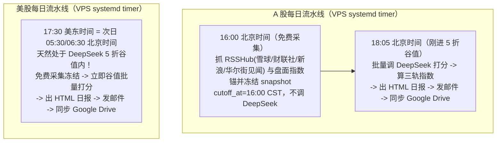

# Emotion Index 最终工程开发规格书（V2 任务书 · 可直接移交编码模型执行）

> [!IMPORTANT]
> **给下游编码模型的铁律**：
> 1. 仓库根目录唯一路径为 `D:\ChatGPT\projects\emotion-index`（远端 `EFSing/emotion-index`，默认主分支 `main`，内聚虚拟环境 `.venv`）。
> 2. 动任何代码前，**必须先读** [AGENTS.md](../AGENTS.md)、[HANDOFF.md](../HANDOFF.md)、[ARCHITECTURE.md](ARCHITECTURE.md) 与 [test_architecture.py](../tests/test_architecture.py)。
> 3. 所有新增代码必须继续通过 `python -m unittest discover -s tests -v`（严守 7 层单向无环架构、纯计算层禁 I/O、Git 零运行产物与零密钥泄漏）。
> 4. **禁止**编写任何小红书/雪球验证码绕过、签名逆向硬破解或违规反爬对抗代码。
> 5. **严禁引入 `akshare` 依赖**（已从用户生产体系中淘汰，云端/VPS 极易限流和接口失效；所有数据源必须使用官方免费 API、标准 RSS / VPS 自托管 RSSHub，或复用已有稳定行情源 `yfinance` / 腾讯 / 新浪 / `BaoStock`）。

---

## 一、 已拍板的全部业务与成本约束

| 维度 | 最终拍板决策 |
| :--- | :--- |
| **监控市场** | **美股（`US`）** 与 **A 股（`CN`）** 严格双池隔离（各自独立快照、账本、权重与日报） |
| **监控粒度** | **大盘整体情绪**（美股 SPY/QQQ/大盘热词；A 股大 A/沪深 300/创业板） + **4 大对称宏观风格板块**（不做千股撒网） |
| **4 大对称板块** | `TECH_GROWTH`（科技成长）、`CYCLICAL_FINANCE`（顺周期与金融）、`DEFENSIVE_DIVIDEND`（防御红利）、`HIGH_BETA_THEME`（高弹性题材与小盘） |
| **费用红线** | **零新增付费数据源、不买域名**；仅复用现有 **DeepSeek API**，且**强制谷值 5 折窗口调用 + 严格配额 + 哈希缓存** |
| **数据源策略** | **VPS 100% 免费公开源全自动采集**；**小红书**保留高权重插件位，作为“极端变盘日/按需人工校准源（`.runtime/inbox/xhs/`）”，绝不阻塞日常自动化 |
| **情绪指标形态** | **三轨并列 + 合成总分 + 背离警示**：① 社交文本极性（0–100）；② 近 20 日声量 Z-Score；③ 客观盘面情绪锚（A 股宽基/风格量价锚 / 美股 CNN 恐慌贪婪 & VIX） |
| **交付方式** | 复用现有 VPS 定时调度，每日收盘生成自包含中文 HTML 日报 + **邮件推送** + **异常/极端情绪 Bark 提醒**，并输出只读 `emotion_summary.json` 契约 |
| **历史数据存储** | VPS 本地 `.runtime/data/` 滚动保存 + **自动增量同步至 Google Drive 专用目录 `EmotionIndex/`**（Git 严禁入库任何数据与 HTML） |

---

## 二、 免费全自动数据源清单与小红书高权重槽位

### 1. 美股（`US`）情绪数据池（全免费、零 AKShare、免风控）
| 渠道 | 角色 | 获取方式 | 建议基础权重（无小红书时归一化） |
| :--- | :--- | :--- | :--- |
| **ApeWisdom** | Reddit (`r/wallstreetbets`, `r/stocks`, `r/options`) 散户热度聚合 | 免费免 Key 公开 JSON API | 20% |
| **Bluesky (`public.api.bsky.app`)** | 实时海外美股大盘与 4 大板块讨论帖 | 官方免费免 Key 搜索 API | 20% |
| **StockTwits v2** | 自带发帖人 `Bullish/Bearish` 标签的美股社区流（聚焦 `SPY`/`QQQ`/板块龙头 ETF） | 官方公开流 API（控制频率） | 20% |
| **雪球热门讨论与精选大 V（美股路由过滤）** | 中文高净值/活跃美股散户讨论温度 | **VPS 自托管 RSSHub**（`/xueqiu/hots` + 可选 `/xueqiu/user/:id`；低频单次拉取，Cookie 过期时单源优雅降级并 Bark 提醒） | 20% |
| **中文美股快讯流**（华尔街见闻全球 + 财联社美股电报 + 金十宏观） | 中文市场对美股的实时情绪风向 | **标准 RSS / VPS 自托管 Docker RSSHub**（`/wallstreetcn/news/global`、`/cls/telegraph`、`/jin10/telegraph`） | 20% |
| **美股客观盘面情绪锚**（`Finnhub` 免费层新闻情绪 + `CNN Fear & Greed` + `yfinance` 的 `^VIX`/`SPY`/`QQQ`/`IWM`/`XLU` 风格强弱） | 客观盘面情绪锚（轨③，不混入文本极性） | 免费公开 API + 复用既有稳定行情源 `yfinance` | 独立展示（轨③ + 参与背离校验） |
| **小红书美股（可选校准源）** | 中文散户极端情绪温度计（高权重插件） | `.runtime/inbox/xhs/` 导入 | **存在时占 30%**（其余自动源按比例缩至 70%）；缺失时正常出报并标明 `XHS_NOT_PROVIDED` |

### 2. A 股（`CN`）情绪数据池（全免费、零 AKShare、免风控）
| 渠道 | 角色 | 获取方式 | 建议基础权重（无小红书时归一化） |
| :--- | :--- | :--- | :--- |
| **雪球热门讨论与精选大 V（A 股路由过滤）** | A 股活跃散户与深度投资者核心情绪源 | **VPS 自托管 RSSHub**（`/xueqiu/hots` + 可选 `/xueqiu/user/:id`；低频单次拉取，Cookie 过期时单源优雅降级并 Bark 提醒） | 35% |
| **财联社电报（A 股 7x24 快讯）** | A 股盘中与收盘核心催化、政策与市场情绪风向标 | **标准 RSS / VPS 自托管 RSSHub**（`/cls/telegraph`） | 35% |
| **新浪财经滚动 + 华尔街见闻 / 金十（A 股过滤）** | 综合财经舆情与宏观预期补充 | **标准 RSS / VPS 自托管 RSSHub**（`/sina/news/roll` 等） | 20% |
| **集思录 / 公开财经热榜（低频辅助）** | 社区讨论关注度补充（单源失败自动降级） | **VPS 自托管 RSSHub**（仅用免登公开路由） | 10% |
| **A 股客观盘面情绪锚**（上证/沪深300/创业板/科创50/中证2000/红利指数涨跌幅、相对 20 日均量比、四大风格相对强弱；如已有高积分 Tushare 可选叠加涨跌停赚钱效应） | 客观盘面情绪锚（轨③） | **复用现有 `stock-data-pipeline` 稳定免费源**：`yfinance` / 腾讯 / 新浪指数快照 / `BaoStock`（彻底不碰 `akshare`） | 独立展示（轨③ + 参与背离校验） |
| **小红书 A 股（可选校准源）** | 中文散户极端情绪温度计（高权重插件） | `.runtime/inbox/xhs/` 导入 | **存在时占 40%**（其余自动源按比例缩至 60%）；缺失时正常出报并标明 `XHS_NOT_PROVIDED` |

---

## 三、 DeepSeek API 省钱铁律与谷值错峰调度架构

> [!TIP]
> **经核实的 DeepSeek API 谷值 5 折窗口（2026）**：
> - **高峰全价时段（仅限周一至周五，不含中国法定节假日）**：北京时间 `09:00–12:00` 与 `14:00–18:00`（UTC `01:00–04:00` & `06:00–10:00`）。
> - **谷值 5 折时段**：北京时间 `18:00–次日 09:00`、`12:00–14:00`、以及**全周末与法定节假日全天**。

### 1. 采集与打分双阶段解耦（兼顾“盘后精确时点”与“100% 吃满 5 折谷值”）


### 2. DeepSeek 调用 5 条硬防线（防烧钱、防幻觉、防漂移）
1. **代码级谷值门禁（Peak Guard）**：`integrations/deepseek_client.py` 默认检测当前北京时间，若落在工作日高峰窗口（`09:00–12:00` 或 `14:00–18:00`）则**直接拒绝发请求并报错**，除非命令行显式传入 `--allow-peak`。
2. **模型固定与批量打包**：仅使用 `deepseek-chat` + `response_format={"type": "json_object"}`，每批打包 **20～30 条帖子**，一次请求返回结构化数组。
3. **每日条数硬配额（Quota Cap）**：进入 LLM 前按互动权重/代表性精选排序，每个市场每日送审上限默认为 **Top 100 条**（配置可调），单日总 Token 消耗控制在极低水平（谷值价约几分钱人民币/天）。
4. **内容哈希持久化缓存**：在 `.runtime/cache/llm_scores.sqlite`（或 JSONL）按 `(sha256(platform + normalized_text), prompt_version, model_name)` 缓存打分结果。重跑报告、补跑历史、修改 HTML 模板时 **100% 命中缓存、零额外 API 费用**。
5. **故障透明降级**：若 DeepSeek API 余额不足/超时/返回非法 JSON（重试 2 次后仍失败），自动回退到纯内存 `bilingual_lexicon_v1` 词典打分，并在报告顶部与 JSON 审计字段中显著标注 `scoring_mode = "DEGRADED_LEXICON"`（同时触发 Bark 告警通知检查额度）。

### 3. DeepSeek 结构化返回 Schema（每条帖子）
```json
{
  "post_id": "string",
  "polarity": -0.75,
  "emotion_state": "PANIC_CAPITULATION",
  "is_sarcasm": true,
  "sector": "TECH_GROWTH",
  "confidence": 0.88,
  "reason_short": "反讽语气，表面说赢麻了实则吐槽科技股暴跌割肉"
}
```
- `emotion_state` 枚举固定为 5 档：`EUPHORIA_FOMO`、`OPTIMISTIC`、`NEUTRAL`、`ANXIOUS`、`PANIC_CAPITULATION`。
- `sector` 枚举固定为：`BROAD_MARKET`、`TECH_GROWTH`、`CYCLICAL_FINANCE`、`DEFENSIVE_DIVIDEND`、`HIGH_BETA_THEME`。

---

## 四、 三轨情绪口径与背离警示规则

每份市场日报与 `emotion_summary.json` 必须独立输出以下 3 条轨道 + 4 大板块分解：

1. **轨①：社交媒体文本极性指数（`text_emotion_index`, `0.00 – 100.00`）**
   - 由各平台按有效权重加权聚合；同时计算 **狂热占比（`euphoria_ratio`）** 与 **恐慌占比（`panic_ratio`）**。
2. **轨②：讨论声量热度（`volume_zscore_20d`）**
   - 从历史账本 `.runtime/data/ledger/emotion_ledger_<market>.jsonl` 读取最近 20 个交易日的有效总帖数/互动量，计算当日 Z-Score：
     - `Z >= +1.5`：标记 `VOLUME_SPIKE`（高关注度/情绪发酵期）；
     - `Z <= -1.0`：标记 `VOLUME_COLD`（低关注度/交投冷清）；
     - 历史不足 5 个交易日时标记 `WARMUP`（不伪造 Z-Score）。
3. **轨③：客观盘面情绪锚（`market_anchor`）**
   - **A 股**：复用 `yfinance` / 腾讯 / 新浪 / `BaoStock`（**严禁使用 AKShare**），采集宽基与风格指数（上证、沪深300、创业板、科创50、中证2000、红利指数）当日涨跌幅、相对 20 日均量比（活跃度）及 4 大风格强弱差，归一化为 `anchor_score (0–100)`；若本地配置了高积分 `Tushare` Token，可选叠加涨跌停赚钱效应。
   - **美股**：CNN Fear & Greed Index (`0–100`) + `yfinance` 的 `^VIX` 水平与 5 日变化 + `SPY`/`QQQ`/`IWM`/`XLU` 风格强弱。
4. **背离警示规则（`divergence_flags`）**：
   - `SOCIAL_OVERHEATED_VS_MARKET_WEAK`：轨① ≥ 70 且 轨② Z-Score ≥ 1.0，但轨③ ≤ 45（典型散户盲目乐观/诱多风险）。
   - `SOCIAL_PANIC_VS_MARKET_RESILIENT`：轨① ≤ 30，但轨③ ≥ 55（典型情绪冰点/潜在反向机会）。
   - `EXTREME_EUPHORIA_WARNING` / `EXTREME_CAPITULATION_ALERT`：轨① ≥ 80 或 ≤ 20（触发 Bark 实时提醒）。

---

## 五、 Google Drive 历史归档与跨项目只读契约

### 1. 目录与同步边界（保持本地干净、Git 零脏污）
- **VPS 本地运行目录（Git 忽略）**：
  - `.runtime/data/raw/<market>/<platform>/<YYYY-MM-DD>.json`：原始采集快照 + `fetched_at` + SHA-256。
  - `.runtime/data/ledger/emotion_ledger_<market>.jsonl`：按日追加的轻量化历史账本（计算 20 日 Z-Score 与画历史趋势图的数据源）。
  - `.runtime/cache/llm_scores.sqlite`：DeepSeek 打分内容哈希缓存。
  - `.runtime/artifacts/daily/EMOTION_<market>_<YYYY-MM-DD>_<session>.html`：自包含离线中文日报。
  - `.runtime/artifacts/daily/emotion_summary_<market>_<YYYY-MM-DD>.json`：对外标准只读契约（供未来 `us_stock_watchlist` / `ashare-watchlist` / `qqq-option-research` 消费）。
- **Google Drive 远端目录（`EmotionIndex/`）**：
  - 优先采用 `rclone copy`（或 `google-auth` + Google Drive API v3），在每次日报生成后将 `raw/`、`ledger/`、`artifacts/daily/`、`cache/` 增量同步到 Google Drive `EmotionIndex/`。
  - VPS 本地仅保留最近 60 天原始快照，历史全量永久沉在 Google Drive，新设备一键同步即可完整恢复历史曲线。

---

## 六、 给编码模型的分阶段 PR 拆分清单（严格防乱节奏）

> 每次只做一个 PR，在独立功能分支开发、通过 `python -m unittest discover -s tests -v`（含 `test_architecture.py`）和 `git diff --check` 后再合并回 `main`。

1. **PR-1：双市场核心契约 + 4 大板块 + 三轨聚合与背离引擎（纯内存）**
   - 改动范围：`configs/weights.json`、`configs/sectors.json`、`domain/`、`sources/`、`sentiment/`、`research/`、`tests/`。
   - 验收标准：不联网全离线通过单元测试；覆盖缺源降级、小红书高权重自动重归一化、20 日 Z-Score 热身期与正常期、背离标记。
2. **PR-2：免费公开数据源适配器（零 AKShare）+ 小红书标准 Inbox 插件位**
   - 改动范围：`integrations/providers/`（`apewisdom.py`、`bluesky.py`、`stocktwits.py`、`rss_feeds.py`、`us_anchor.py`、`cn_anchor.py`、`xhs_inbox.py`）、`app/cli.py`（新增 `capture` 子命令）。
   - 验收标准：零 `akshare` 依赖（在 `test_architecture.py` 中静态禁 import `akshare`）；单源失败不拖垮整轮采集；原始响应按 SHA-256 + `available_at` 冻结落地到 `.runtime/data/raw/`；`test_architecture.py` 全绿。
3. **PR-3：DeepSeek 谷值门禁客户端 + 哈希持久化缓存 + 词典双轨降级**
   - 改动范围：`integrations/deepseek_client.py`、`integrations/score_cache.py`、`sentiment/bilingual_lexicon.py`、`app/cli.py`（新增 `score` 子命令）。
   - 验收标准：单元测试验证高峰窗口自动拦截（除非 `--allow-peak`）、二次运行 100% 命中缓存零请求、API 异常时自动回退并标 `DEGRADED_LEXICON`。
4. **PR-4：三轨中文 HTML 日报 + JSONL 历史账本 + Google Drive 同步 + VPS 定时与邮件/Bark 通知**
   - 改动范围：`reporting/html_report.py`、`integrations/ledger.py`、`integrations/gdrive_sync.py`、`integrations/notifier.py`、`deploy/systemd/`（A 股 16:00 采集 / 18:05 谷值出报、美股美东 17:30 采集+谷值出报模板）。
   - 验收标准：端到端干跑生成美股与 A 股两份离线自包含 HTML 日报（内含历史趋势图、4 大板块温度表、背离警示与 JSON 审计区），邮件与 Google Drive 同步验收通过。
